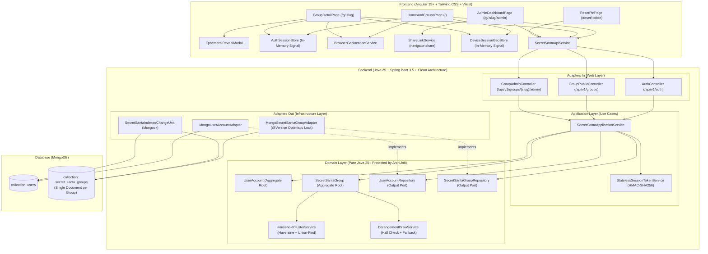
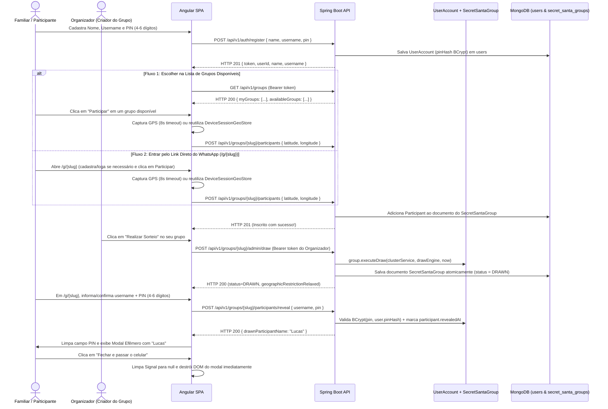

# Amigo Secreto Familiar Mobile-First Design

**Spec**: `.specs/features/secret-santa/spec.md`
**Status**: Approved

---

## Architecture Overview

A solução adota **Clean Architecture / Hexagonal com DDD Tático Rico** no backend (**Java 25 + Spring Boot 3.5+ + Maven + MongoDB + ArchUnit**) e uma SPA **Mobile-First Reativa** no frontend (**Angular 19+ Standalone + Signals + Native Control Flow `@if`/`@for` + Reactive Forms + Tailwind CSS + Vitest**), organizada em monorepo (`backend/`, `frontend/` e `docker-compose.yml` na raiz).

### Backend Technology Stack (`AD-005`, `AD-001`)

| Camada Backend | Tecnologia Escolhida | Papel na Arquitetura |
| -------------- | -------------------- | -------------------- |
| **Linguagem & Runtime** | **Java 25** (Records, Pattern Matching, Sealed Interfaces) + **Maven** | Modelagem expressiva e imutável para Value Objects (`Username`, `PinHash`, `GeoCoordinates`, `GroupSlug`), resultados de domínio e exceções tipadas. |
| **Framework & Web** | **Spring Boot 3.5+** (`spring-boot-starter-web`, `validation`, `spring-security-crypto`) | Exposição REST `/api/v1/auth` e `/api/v1/groups`, token stateless HMAC-SHA256 (`Authorization: Bearer <token>`), hash BCrypt para `pinHash` dos usuários e hash SHA-256 para tokens de uso único de redefinição de PIN (`AD-001`). |
| **Banco de Dados & Persistência** | **MongoDB** (`spring-boot-starter-data-mongodb`, `auto-index-creation: true`, **Mongock**) | Dois Aggregates com documento único por Aggregate Root: collection `users` (`UserAccount`, índice único em `username`) e collection `secret_santa_groups` (`SecretSantaGroup` com `participants` embutidos, `organizerUserId`, índice único em `publicSlug` e `@Version` para lock otimista). |
| **Governança de Clean Architecture** | **ArchUnit** (`archunit-junit5`) | Testes automatizados garantindo que `com.secretsanta.domain` não dependa de Spring, MongoDB, Jackson ou camadas externas (`application`, `infrastructure`, `web`). |
| **Testes de Integração & Ambiente Local** | **Testcontainers MongoDB** (com fallback automático para **`mongo-java-server`** in-memory quando Docker não está acessível) + **`docker-compose.yml`** | Execução 100% determinística de `mvn test` em qualquer ambiente (com ou sem daemon Docker) e subida imediata do banco local via Docker Compose. |

### Frontend Technology Stack (`AD-004`, `AD-001`)

| Camada Frontend | Tecnologia Escolhida | Papel na Arquitetura |
| --------------- | -------------------- | -------------------- |
| **Framework & Reatividade** | **Angular 19+** (Standalone Components, Signals `signal`/`computed`, Native Control Flow `@if`/`@for`) | Zero `NgModules`, estado de sessão em memória (`AuthSessionStore`) para suportar o botão `"Cadastrar outro familiar / Trocar de usuário neste aparelho"` e limpeza imediata no fluxo `"Passar o Celular"`. |
| **Formulários** | **Angular Reactive Forms** (`NonNullableFormBuilder`, `Validators`) | Validação síncrona imediata para cadastro/login (`name`, `username` auto-sugerido/editável, `pin` numérico 4..6 dígitos), criação de grupo, revelação (`username` + `pin`) e redefinição de PIN (`/reset/:token`). |
| **Estilização & UI** | **Tailwind CSS** + Componentes próprios Mobile-First | Container mobile-first (`max-w-md mx-auto min-h-dvh`), botões com alvo de toque mínimo de `48px` (`min-h-12`), alto contraste para crianças e idosos e zero overhead de bibliotecas pesadas. |
| **Ícones** | **Lucide Angular / SVGs Inline Leves** | Ícones vetoriais leves para status de GPS, revelação, compartilhamento, chave de redefinição e troca de familiar. |
| **Compartilhamento Mobile** | **Web Share API (`navigator.share`)** + fallback `navigator.clipboard.writeText` | Permite enviar tanto o link direto do grupo (`/g/{slug}`) quanto o link único de redefinição (`/reset/{token}`) diretamente no WhatsApp com 1 toque. |
| **Testes Unitários** | **Vitest** (`vitest run --reporter=verbose` + `@angular/core/testing`) | Execução headless rápida e determinística sem depender de binário do Chrome instalado no ambiente. |

### Strategic Domain Analysis (DDD)

| Subdomain | Classification | Ubiquitous Language | Responsibility |
| --------- | -------------- | ------------------- | -------------- |
| **Draw & Household Clustering** | **Core Domain** | `Desarranjo (Derangement)`, `Núcleo Familiar (HouseholdCluster)`, `Distância Haversine`, `Relaxamento Geográfico` | Agrupar participantes num raio de `<= 50m` via componentes conexos (Union-Find) e sortear pares sem auto-sorteio e sem pares da mesma residência (com fallback matemático quando `max_cluster > floor(N / 2)`). |
| **Group Discovery & Lifecycle** | **Supporting Subdomain** | `Grupo (SecretSantaGroup)`, `Organizador (organizerUserId)`, `Grupos Disponíveis`, `Meus Grupos`, `Link Direto (/g/{slug})` | Criação de grupo pelo usuário logado, listagem de grupos abertos para inscrição com 1 toque pós-cadastro, entrada direta via WhatsApp e exclusão de participantes pré-sorteio. |
| **User Identity & Ephemeral Reveal** | **Supporting Subdomain** | `Conta de Usuário (UserAccount)`, `Username`, `PIN (4-6 dígitos)`, `Link de Redefinição (/reset/{token})`, `Trocar de Usuário no Aparelho` | Cadastro básico rápido, login, redefinição de PIN por link de uso único gerado pelo organizador e revelação efêmera protegida por `username` + `PIN`. |

### Component & Interaction Diagram (Clean Architecture)



### Sequence: Cadastro Básico, Descoberta de Grupos / Link WhatsApp, Sorteio e Revelação



---

## Code Reuse Analysis

### Existing Components to Leverage

| Component | Location | How to Use |
| --------- | -------- | ---------- |
| Decisões Arquiteturais (`AD-002` a `AD-001`) | `.specs/STATE.md` | Restrições ativas obrigatórias para algoritmo Haversine/Hall, memória volátil no frontend, stack Angular/Tailwind/Vitest, MongoDB com Clean Architecture e identidade `UserAccount` com descoberta de grupos. |
| Padrões de Domínio Rico (`tactical-ddd`) | `.claude/skills/tactical-ddd/SKILL.md` | Encapsular invariantes dentro dos Aggregates `UserAccount` e `SecretSantaGroup` e Value Objects imutáveis (`record` do Java 25), sem dependências de framework no pacote `domain`. |

### Integration Points

| System | Integration Method |
| ------ | ------------------ |
| MongoDB | Spring Data MongoDB implementando os Output Ports `UserAccountRepository` (`collection: users`) e `SecretSantaGroupRepository` (`collection: secret_santa_groups`), com índices únicos em `username` e `publicSlug` (`auto-index-creation: true` + inicializador Mongock) e controle otimista `@Version`. |
| Browser Geolocation & Share APIs | Wrappers Angular `BrowserGeolocationService` (`navigator.geolocation.getCurrentPosition` com timeout de 8s) e `ShareLinkService` (`navigator.share` com fallback `navigator.clipboard.writeText`). |

---

## Components

### Backend — Domain Layer (`com.secretsanta.domain` — 100% Pure Java 25)

#### `UserAccount` (Aggregate Root)

- **Purpose**: Representar o cadastro básico de cada familiar (`id`, `name`, `username`, `pinHash`, `resetTokenHash`, `resetTokenExpiresAt`, `createdAt`) e governar a emissão e o consumo de tokens de uso único para redefinição de PIN.
- **Location**: `backend/src/main/java/com/secretsanta/domain/model/UserAccount.java`
- **Interfaces**:
  - `static UserAccount register(ParticipantName name, Username username, PinHash pinHash, Instant now)`
  - `void issuePasswordResetToken(PasswordResetTokenHash tokenHash, Instant expiresAt)`
  - `void resetPinWithToken(PasswordResetTokenHash tokenHash, PinHash newPinHash, Instant now)`

#### `SecretSantaGroup` (Aggregate Root)

- **Purpose**: Governa o ciclo de vida do grupo (`OPEN` → `DRAWN`), permissão do organizador (`organizerUserId`), inscrição de usuários (`userId`, `name`, `username`, `coordinates`), remoção pré-sorteio, disparo atômico do sorteio e revelação do Amigo Secreto.
- **Location**: `backend/src/main/java/com/secretsanta/domain/model/SecretSantaGroup.java`
- **Interfaces**:
  - `static SecretSantaGroup create(String eventName, GroupSlug slug, UUID organizerUserId, Instant now)`
  - ` void assertOrganizer(UUID requesterUserId)` - lança `UnauthorizedOrganizerAccessException` se `requesterUserId != organizerUserId`.
  - `Participant registerParticipant(UUID userId, ParticipantName name, Username username, GeoCoordinates coordinates, Instant now)` - adiciona participante se `OPEN` e se o `userId`/`username` ainda não estiver inscrito no grupo.
  - `void removeParticipant(UUID participantId)` - remove participante se `OPEN`, lançando `GroupAlreadyDrawnException` se `DRAWN`.
  - `DrawResult executeDraw(HouseholdClusterService clusterService, DerangementDrawService drawService, Instant now)`
  - `Participant findParticipantByUsername(Username username)`
  - `String markRevealedAndGetDrawnName(UUID participantId, Instant now)`

#### `Value Objects` (`GroupSlug`, `ParticipantName`, `Username`, `PinHash`, `PasswordResetTokenHash`, `GeoCoordinates`)

- **Purpose**: Garantir auto-validação na construção e imutabilidade de primitivas de domínio:
  - `Username(String value)`: faz `trim().toLowerCase(Locale.ROOT)` e valida `3..30` caracteres no padrão `^[a-z0-9._-]+$`.
  - `PinHash(String value)` & `PinValidator.validateRawPin(String rawPin)`: garante PIN numérico de 4 a 6 dígitos (`^\d{4,6}$`).
  - `PasswordResetTokenHash(String value)`: hash SHA-256 hex do token de uso único de redefinição de PIN.
  - `GeoCoordinates(double latitude, double longitude)`: valida `-90..90` e `-180..180` e expõe `double distanceInMetersTo(GeoCoordinates other)` usando Haversine (`R = 6_371_000.0` metros).
  - `ParticipantName(String value)`: faz `trim()`, valida 2..60 caracteres e expõe `String normalizedKey()`.
- **Location**: `backend/src/main/java/com/secretsanta/domain/model/`

#### `HouseholdClusterService` & `DerangementDrawService` (Domain Services)

- **Purpose**:
  - `HouseholdClusterService`: agrupa participantes em componentes conexos (Union-Find) para distância Haversine `<= 50.0` metros e isola participantes sem GPS (`coordinates == null`) em núcleos individuais exclusivos.
  - `DerangementDrawService`: verifica a condição do Teorema de Hall (`max_cluster_size <= floor(N / 2)`) e gera desarranjo estrito entre núcleos distintos (`geographicRestrictionRelaxed = false`) ou aplica fallback automático minimizando pares intra-núcleo sem auto-sorteio (`geographicRestrictionRelaxed = true`).
- **Location**: `backend/src/main/java/com/secretsanta/domain/service/`

#### `UserAccountRepository` & `SecretSantaGroupRepository` (Output Ports)

- **Purpose**: Interfaces puras de domínio para persistência e consulta dos Aggregates `UserAccount` e `SecretSantaGroup`.
- **Location**: `backend/src/main/java/com/secretsanta/domain/port/`

---

### Backend — Application, Infrastructure & Web Layers

#### `SecretSantaApplicationService` & `StatelessSessionTokenService` (`com.secretsanta.application`)

- **Purpose**: Orquestrar cadastro/login de usuário, emissão/validação de token de sessão HMAC-SHA256 stateless, descoberta de grupos (`myGroups` e `availableGroups`), inscrição no grupo com retry otimista (`@Version`), administração pelo `organizerUserId`, emissão/consumo de link `/reset/{token}` e revelação autenticada por `username` + `pin`.
- **Location**: `backend/src/main/java/com/secretsanta/application/`

#### `MongoUserAccountAdapter` & `MongoSecretSantaGroupAdapter` (`com.secretsanta.infrastructure.persistence`)

- **Purpose**: Persistir `UserAccountDocument` na collection `users` e `SecretSantaGroupDocument` (com `ParticipantSubDocument` embutidos e `@Version`) na collection `secret_santa_groups`, com índices únicos garantidos via `@Indexed(unique = true)` e `SecretSantaIndexesChangeUnit` (Mongock).
- **Location**: `backend/src/main/java/com/secretsanta/infrastructure/persistence/`

#### `AuthController`, `GroupPublicController`, `GroupAdminController` & `GlobalExceptionHandler` (`com.secretsanta.web`)

- **Purpose**:
  - `AuthController`:
    - `POST /api/v1/auth/register` (cadastra `name`, `username`, `pin` → retorna token + perfil)
    - `POST /api/v1/auth/login` (autentica `username`, `pin` → retorna token + perfil)
    - `POST /api/v1/auth/reset-pin` (consome `token` de uso único e define `newPin` para o `UserAccount`)
  - `GroupPublicController`:
    - `GET /api/v1/groups` (retorna `myGroups` e `availableGroups` para o usuário autenticado)
    - `GET /api/v1/groups/{slug}` (retorna estado do grupo, se o usuário atual já está inscrito/é organizador e lista de inscritos)
    - `POST /api/v1/groups/{slug}/participants` (inscreve o usuário autenticado no grupo `OPEN` com `latitude`/`longitude` opcionais)
    - `POST /api/v1/groups/{slug}/participants/reveal` (valida `username` + `pin` e retorna `drawnParticipantName`)
  - `GroupAdminController`:
    - `POST /api/v1/groups` (cria grupo definindo o usuário autenticado como `organizerUserId`)
    - `GET /api/v1/groups/{slug}/admin` (lista inscritos para o organizador)
    - `DELETE /api/v1/groups/{slug}/admin/participants/{participantId}` (remove inscrito enquanto `OPEN`)
    - `POST /api/v1/groups/{slug}/admin/draw` (executa sorteio)
    - `POST /api/v1/groups/{slug}/admin/participants/{participantId}/reset-token` (gera link `/reset/{token}`)
- **Location**: `backend/src/main/java/com/secretsanta/web/`

---

### Frontend — Angular 19+ Mobile-First SPA (`frontend/src/app`)

#### Rotas Principais (`app.routes.ts`)

- `/` → `HomeGroupsPageComponent` (Cadastro/Login e, quando autenticado, **Meus Grupos** + **Grupos Disponíveis (Abertos)** + **Criar Grupo** + botão **Cadastrar outro familiar / Trocar de usuário neste aparelho**)
- `/g/:slug` → `PublicGroupPageComponent` (Entrada por link direto do WhatsApp: permite criar cadastro/logar na hora se não autenticado, inscrever-se com 1 clique quando `OPEN` ou revelar quem tirou com `username` + `PIN` quando `DRAWN`)
- `/g/:slug/admin` → `AdminDashboardPageComponent` (Painel exclusivo do `organizerUserId`: compartilhar `/g/{slug}`, ver inscritos, remover antes do sorteio, gerar link `/reset/{token}` e disparar sorteio)
- `/reset/:token` → `ResetPinPageComponent` (Redefinição de PIN por link único)

---

## Data Models

### MongoDB Document Models

#### Collection `users`

```json
{
  "_id": "a1b2c3d4-e5f6-4a5b-8c9d-0e1f2a3b4c5d",
  "name": "Tiago Godoy",
  "normalizedName": "tiago godoy",
  "username": "tiago.godoy",
  "pinHash": "$2a$10$...",
  "resetTokenHash": null,
  "resetTokenExpiresAt": null,
  "createdAt": "2026-11-13T18:00:00Z",
  "version": 1
}
```

#### Collection `secret_santa_groups` (Single Document per Aggregate)

```json
{
  "_id": "f47ac10b-58cc-4372-a567-0e02b2c3d479",
  "publicSlug": "natal-familia-silva-a8f2",
  "eventName": "Natal Família Silva",
  "organizerUserId": "a1b2c3d4-e5f6-4a5b-8c9d-0e1f2a3b4c5d",
  "status": "DRAWN",
  "geographicRestrictionRelaxed": false,
  "createdAt": "2026-11-13T18:00:00Z",
  "drawnAt": "2026-11-13T19:00:00Z",
  "version": 4,
  "participants": [
    {
      "id": "11111111-2222-3333-4444-555555555555",
      "userId": "a1b2c3d4-e5f6-4a5b-8c9d-0e1f2a3b4c5d",
      "name": "Tiago Godoy",
      "username": "tiago.godoy",
      "latitude": -23.420999,
      "longitude": -51.933056,
      "householdClusterId": "aaaa1111-bbbb-cccc-dddd-eeeeffff0001",
      "drawnParticipantId": "66666666-7777-8888-9999-000000000000",
      "revealedAt": null,
      "createdAt": "2026-11-13T18:05:00Z"
    }
  ]
}
```

---

## Error Handling Strategy

| Error Scenario | Handling | User Impact |
| -------------- | -------- | ----------- |
| Dados inválidos (`name` fora de 2..60, `username` fora de `^[a-z0-9._-]{3,30}$`, `pin` fora de `^\d{4,6}$`) | Bean Validation + Value Objects lançam `DomainValidationException` → HTTP 400 Bad Request | Mensagem inline clara indicando o campo inválido. |
| Token de sessão ausente/inválido ou `username`/`pin` incorretos no login/revelação | `InvalidCredentialsException` → HTTP 401 Unauthorized | UI informa que o username ou PIN está incorreto. |
| Usuário autenticado tenta acessar `/admin` de um grupo cujo `organizerUserId` é outro usuário | `UnauthorizedOrganizerAccessException` → HTTP 403 Forbidden | UI bloqueia o acesso administrativo para quem não é o organizador do grupo. |
| Token de redefinição inexistente, já usado ou expirado (`POST /api/v1/auth/reset-pin`) | `InvalidPasswordResetTokenException` → HTTP 400 Bad Request | UI informa que o link é inválido ou expirou. |
| `username` já cadastrado ou usuário já inscrito no mesmo grupo | HTTP 409 Conflict | UI orienta a fazer login ou escolher outro `username`. |
| Sorteio acionado com menos de 3 participantes | `InsufficientParticipantsForDrawException` → HTTP 422 Unprocessable Entity | Botão de sorteio exibe aviso de mínimo de 3 inscritos. |

---

## Risks & Concerns

| Concern | Location (file:line) | Impact | Mitigation |
| ------- | -------------------- | ------ | ---------- |
| Condição de corrida entre inscrição tardia e disparo do sorteio no mesmo documento MongoDB | `MongoSecretSantaGroupAdapter` / `SecretSantaApplicationService` | Duas requisições simultâneas lerem a mesma versão do documento do grupo. | Usar `@Version` no `SecretSantaGroupDocument` com retry curto (até 3 tentativas) em `OptimisticLockingFailureException`. |
| Execução de testes de integração MongoDB em ambientes onde o daemon Docker está bloqueado por sandbox | `MongoTestContainerConfig` (`src/test/java`) | Testes falharem se dependerem exclusivamente de socket Docker em ambiente restrito. | Inicializador que tenta Testcontainers MongoDB e faz fallback transparente para `mongo-java-server` in-memory (`AD-005`). |
| Vazamento do Amigo Secreto, PIN ou sessão no compartilhamento de celular ("Passar o Celular") | `EphemeralRevealModalComponent` / `AuthSessionStore` | Próximo familiar ver o nome sorteado ou agir na conta anterior. | Manter sessão e revelação em Signals de memória (`AuthSessionStore` e `EphemeralRevealModalComponent`), limpando o modal no fechamento/`ngOnDestroy`/`visibilitychange` e oferecendo o botão `"Cadastrar outro familiar / Trocar de usuário neste aparelho"` que zera a sessão mantendo apenas o GPS em memória (`AD-003`, `AD-001`). |

---

## Tech Decisions

| Decision | Choice | Rationale |
| -------- | ------ | --------- |
| Identidade `UserAccount` + Descoberta de Grupos + Organizador vinculado | `users` collection + `organizerUserId` em `secret_santa_groups` (`AD-001`) | Permite que após o cadastro básico o usuário veja todos os grupos abertos para entrar com 1 clique ou entre via link do WhatsApp, além de tornar o criador automaticamente o Organizador do grupo. |
| Banco de Dados e Modelagem do Aggregate | MongoDB com Documento Único por `SecretSantaGroup` + `@Version` (`AD-005`) | Atomicidade nativa no nível do documento tanto no sorteio quanto nas inscrições. |
| Verificação automatizada de Clean Architecture | ArchUnit (`CleanArchitectureTest`) | Garante em tempo de build que nenhuma classe em `com.secretsanta.domain` importe pacotes de `org.springframework`, `org.mongodb`, `io.mongock` ou camadas externas. |
