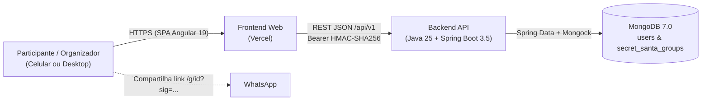

# 🎅 Amigo Secreto — Familiar & Mobile-First

Aplicação web **Mobile-First** para organização e sorteio de **Amigo Secreto Familiar**, projetada para compartilhamento rápido pelo WhatsApp e com suporte nativo ao modo **"Passar o Celular"** (múltiplos familiares usando o mesmo aparelho sem vazamento de sessão ou do amigo sorteado).

---

## ✨ Principais Funcionalidades

- **Identidade Simples por PIN**: Cadastro único com nome, nome de usuário (normalizado em minúsculas) e PIN numérico de 4 a 6 dígitos protegido com hash **BCrypt**.
- **Grupos Privados com Convite Assinado**: Cada grupo possui um `UUID` e uma assinatura criptográfica **HMAC-SHA256** persistida (`?sig=...`). Somente quem possui o link completo pode visualizar os participantes e ingressar — com suporte a **rotação do link de convite** pelo organizador.
- **Organizador sem Senha Extra**: Quem cria o grupo torna-se automaticamente o organizador (`organizerUserId`), com acesso ao painel administrativo (`/g/{groupId}/admin`) para remover participantes, executar o sorteio, rotacionar o convite e gerar links únicos de redefinição de PIN (`/reset/{token}`).
- **Restrição Geográfica de Residência (`<= 50m`)**: Agrupamento automático de participantes por proximidade GPS usando a **fórmula de Haversine** e **Union-Find** (`<= 50 metros`). O algoritmo garante que moradores da mesma casa não tirem uns aos outros sempre que matematicamente possível (`tamanho_max_nucleo <= floor(N / 2)`), aplicando relaxamento automático apenas quando uma mesma residência concentra mais da metade do grupo.
- **Sigilo Efêmero & Modo "Passar o Celular"**: O nome sorteado, o PIN e o token de sessão ficam **exclusivamente em memória volátil** (Angular Signals) — nunca em `localStorage`, `sessionStorage`, `IndexedDB`, cookies ou URL. O resultado é limpo ao fechar o modal, ao trocar de usuário ou ao ocultar a aba (`visibilitychange`).
- **Compartilhamento Direto no WhatsApp**: Integração com Web Share API nativa (`navigator.share`), fallback para área de transferência e abertura direta via `wa.me` no desktop.

---

## 🧭 Visão Geral da Arquitetura



---

## 📚 Documentação Técnica (`docs/`)

Toda a documentação detalhada da arquitetura, modelagem, fluxos, segurança e deploy está organizada na pasta [`docs/`](file:///home/tiago.godoy@db1.com.br/workspace/tiaggofg/secret-santa/docs/README.md):

| Documento | Conteúdo |
| :--- | :--- |
| [docs/README.md](file:///home/tiago.godoy@db1.com.br/workspace/tiaggofg/secret-santa/docs/README.md) | Índice geral da documentação |
| [docs/arquitetura-c4.md](file:///home/tiago.godoy@db1.com.br/workspace/tiaggofg/secret-santa/docs/arquitetura-c4.md) | Diagramas C4 (Contexto, Containers, Componentes) e Clean Architecture (ArchUnit) |
| [docs/modelo-dominio-e-dados.md](file:///home/tiago.godoy@db1.com.br/workspace/tiaggofg/secret-santa/docs/modelo-dominio-e-dados.md) | Diagrama de Classes do domínio, Diagrama ER / Documentos MongoDB e Máquina de Estados |
| [docs/fluxos-e-sequencias.md](file:///home/tiago.godoy@db1.com.br/workspace/tiaggofg/secret-santa/docs/fluxos-e-sequencias.md) | Fluxograma de navegação e Diagramas de Sequência (Convite, Sorteio, Revelação Efêmera, Reset PIN) |
| [docs/algoritmo-sorteio.md](file:///home/tiago.godoy@db1.com.br/workspace/tiaggofg/secret-santa/docs/algoritmo-sorteio.md) | Agrupamento geográfico (`<= 50m`), Haversine, Union-Find e desarranjo bipartido |
| [docs/api-rest.md](file:///home/tiago.godoy@db1.com.br/workspace/tiaggofg/secret-santa/docs/api-rest.md) | Catálogo completo de endpoints REST (`/api/v1`), DTOs e códigos de erro |
| [docs/seguranca-e-privacidade.md](file:///home/tiago.godoy@db1.com.br/workspace/tiaggofg/secret-santa/docs/seguranca-e-privacidade.md) | Autenticação stateless, convites HMAC-SHA256, BCrypt e sigilo efêmero no navegador |
| [docs/deploy-e-ci-cd.md](file:///home/tiago.godoy@db1.com.br/workspace/tiaggofg/secret-santa/docs/deploy-e-ci-cd.md) | Docker multi-stage, GHCR, Portainer CE, GitHub Actions e Vercel |

---

## 🛠️ Stack Tecnológica

### Backend (`backend/`)
- **Java 25** (`Records`, `Sealed Interfaces`, `Pattern Matching`) + **Spring Boot 3.5.16** (Maven)
- **MongoDB 7.0** (`spring-boot-starter-data-mongodb`) + **Mongock 5.5.0** para migração idempotente de índices
- **Segurança**: `spring-security-crypto` (BCrypt) + tokens stateless **HMAC-SHA256** (`StatelessSessionTokenService`)
- **Testes & Qualidade**: JUnit 5, **ArchUnit 1.4.2** (`CleanArchitectureTest`), Testcontainers MongoDB com fallback automático para `mongo-java-server` in-memory

### Frontend (`frontend/`)
- **Angular 19.2** (Standalone Components, Signals, `@if`/`@for`, Reactive Forms)
- **Tailwind CSS 3.4** com UI festiva mobile-first de alto contraste
- **Vitest 3.0** + JSDOM para testes unitários headless
- **Proxy local**: `/api` redireciona para `http://localhost:8080` ([proxy.conf.json](file:///home/tiago.godoy@db1.com.br/workspace/tiaggofg/secret-santa/frontend/proxy.conf.json))

---

## 🚀 Início Rápido (Ambiente Local)

### Pré-requisitos
- **Java 25** e **Maven 3.9+**
- **Node.js 20+** e **npm**
- **Docker** e **Docker Compose** (opcional para o MongoDB local; os testes usam fallback in-memory caso o Docker não esteja ativo)

### 1. Subir o MongoDB local
```bash
docker compose up -d
```

### 2. Iniciar o Backend (`http://localhost:8080`)
```bash
cd backend
mvn spring-boot:run
```

### 3. Iniciar o Frontend (`http://localhost:4200`)
```bash
cd frontend
npm install
npm start
```

Acesse `http://localhost:4200` no navegador.

---

## 🧪 Testes e Build

```bash
# Backend — Testes unitários, ArchUnit e integração
cd backend && mvn test

# Frontend — Testes unitários headless (Vitest)
cd frontend && npm test

# Frontend — Build de produção
cd frontend && npm run build
```

---

## ⚙️ Variáveis de Ambiente

### Backend ([application.yml](file:///home/tiago.godoy@db1.com.br/workspace/tiaggofg/secret-santa/backend/src/main/resources/application.yml) e [docker-compose.prod.yml](file:///home/tiago.godoy@db1.com.br/workspace/tiaggofg/secret-santa/docker-compose.prod.yml))
| Variável | Descrição | Padrão (Dev) |
| :--- | :--- | :--- |
| `MONGODB_URI` | String de conexão do MongoDB | `mongodb://localhost:27017/secret_santa` |
| `SECRETSANTA_TOKEN_SECRET` | Segredo HMAC-SHA256 (>= 32 caracteres) para sessão e convites | Chave padrão de desenvolvimento |
| `CORS_ALLOWED_ORIGINS` | Origens permitidas no CORS | `*` |
| `BACKEND_PORT` | Porta exposta no container de produção | `8080` |

### Frontend ([set-env.mjs](file:///home/tiago.godoy@db1.com.br/workspace/tiaggofg/secret-santa/frontend/scripts/set-env.mjs))
| Variável | Descrição | Padrão (Dev) |
| :--- | :--- | :--- |
| `API_BASE_URL` | URL base da API consumida em produção (Vercel) | Proxy `/api` em desenvolvimento |

---

## 📁 Estrutura do Repositório

```text
secret-santa/
├── .github/workflows/      # CI/CD (build, testes, GHCR e redeploy Portainer CE)
├── .specs/                 # Especificações funcionais e decisões arquiteturais (ADRs)
├── backend/                # API REST em Java 25 + Spring Boot 3.5 + MongoDB
│   ├── src/main/java/com/secretsanta/
│   │   ├── domain/         # Entidades, Value Objects, Portas e Serviços de Domínio (Java puro)
│   │   ├── application/    # Casos de uso e tokens stateless HMAC-SHA256
│   │   ├── infrastructure/ # Adaptadores MongoDB e índices Mongock
│   │   └── web/            # Controllers REST, CORS e GlobalExceptionHandler
│   └── Dockerfile          # Build multi-stage com Eclipse Temurin 25
├── docs/                   # Documentação técnica e diagramas Mermaid
├── frontend/               # SPA Angular 19 + Tailwind CSS + Vitest
├── AGENTS.md               # Diretrizes e regras operacionais para agentes de IA
├── docker-compose.yml      # MongoDB 7.0 local
└── docker-compose.prod.yml # Stack de produção (imagem GHCR + healthcheck)
```
