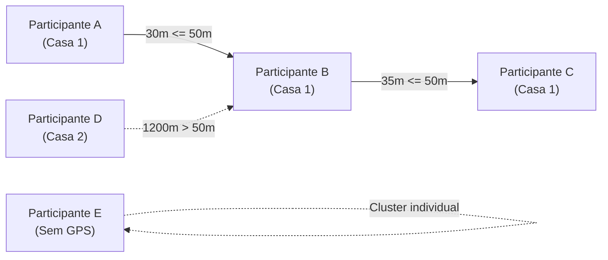
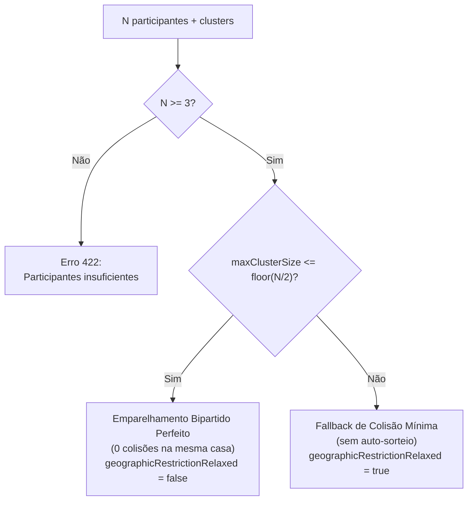

# 🎲 Algoritmo de Sorteio e Agrupamento Geográfico

O motor de sorteio garante que participantes que moram na mesma residência não tirem uns aos outros sempre que houver solução matemática válida, sem jamais bloquear o evento caso uma casa concentre a maioria dos convidados.

---

## 1. Agrupamento de Núcleos Familiares (`HouseholdClusterService`)

A classe [`HouseholdClusterService`](file:///home/tiago.godoy@db1.com.br/workspace/tiaggofg/secret-santa/backend/src/main/java/com/secretsanta/domain/service/HouseholdClusterService.java) agrupa participantes por proximidade geográfica:

1. **Cálculo de Distância (Haversine)**: Para cada par de participantes $(i, j)$ que possuam coordenadas GPS (`GeoCoordinates`), calcula-se a distância geodésica em metros (`distanceInMetersTo`).
2. **Limiar de Residência**: Se `distância <= 50.0` metros (`HOUSEHOLD_RADIUS_METERS`), os participantes pertencem à mesma casa.
3. **Componentes Conexos (Union-Find)**: Utiliza estrutura *Disjoint Set Union* com compressão de caminho (`find`/`union`) para fechar transitivamente os grupos (ex.: se A está a 35m de B e B está a 35m de C, A, B e C ficam no mesmo núcleo).
4. **Sem GPS**: Participantes sem coordenadas recebem um `householdClusterId` individual exclusivo, não sendo restringidos entre si.

---

## 2. Desarranjo e Relaxamento Automático (`DerangementDrawService`)

A classe [`DerangementDrawService`](file:///home/tiago.godoy@db1.com.br/workspace/tiaggofg/secret-santa/backend/src/main/java/com/secretsanta/domain/service/DerangementDrawService.java) executa o sorteio em duas etapas de decisão:

### Pré-condição Mínima
- O grupo deve possuir pelo menos **3 participantes** (`SecretSantaGroup.MIN_PARTICIPANTS_FOR_DRAW = 3`). Caso contrário, lança `InsufficientParticipantsForDrawException` (HTTP `422`).

### Condição de Existência Inter-Residencial

Seja $N$ o total de participantes e $M$ o tamanho do maior núcleo familiar (`maxClusterSize`):

$$M \le \lfloor N / 2 \rfloor$$

- **Quando $M \le \lfloor N / 2 \rfloor$ (Restrição Estrita Satisfatível)**:
  - Constrói um grafo bipartido onde cada doador $i$ só pode se conectar a receptores $j$ de **outro núcleo** (`cluster(i) != cluster(j)`).
  - Embaralha os candidatos com `SecureRandom` e executa busca de **emparelhamento bipartido perfeito** (algoritmo de Kuhn / caminhos aumentantes).
  - Resultado: **0 colisões** intra-residenciais, `geographicRestrictionRelaxed = false`.

- **Quando $M > \lfloor N / 2 \rfloor$ (Relaxamento Automático)**:
  - Pelo Princípio da Casa dos Pombos, é matematicamente impossível evitar que todos os membros do maior núcleo tirem fora da própria casa.
  - O algoritmo aciona o fallback de **colisão mínima** (`generateMinimalCollisionFallbackDerangement`), garantindo que **ninguém tire a si mesmo** (`participantId != drawnParticipantId`), maximizando os pares inter-residenciais e marcando `geographicRestrictionRelaxed = true`.

