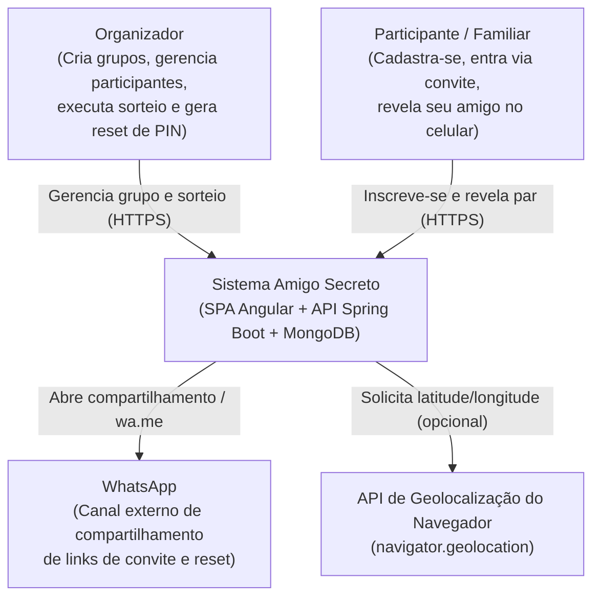
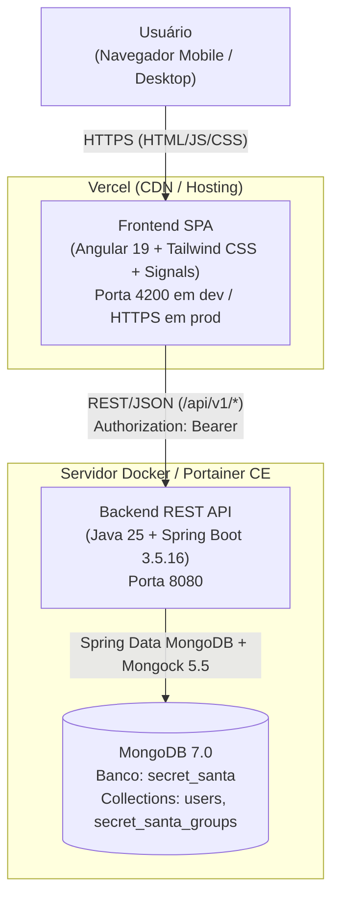
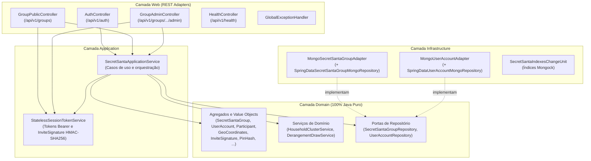
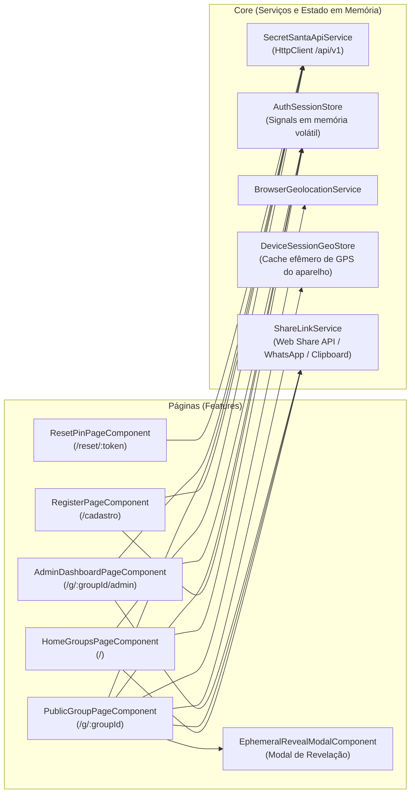

# 🏗️ Arquitetura e Diagramas C4

Este documento apresenta a arquitetura do sistema seguindo o modelo **C4** (Contexto, Containers e Componentes) e detalha os limites arquiteturais impostos pela **Clean Architecture**.

---

## 1. C4 Nível 1 — Diagrama de Contexto

Mostra como os usuários e sistemas externos interagem com a plataforma **Amigo Secreto**.

---

## 2. C4 Nível 2 — Diagrama de Containers

Detalha os processos executáveis, armazenamentos de dados e protocolos de comunicação.

---

## 3. C4 Nível 3 — Diagrama de Componentes

### 3.1. Backend (`com.secretsanta`) — Clean Architecture

### Regra de Dependência (ArchUnit)

A suíte [`CleanArchitectureTest`](file:///home/tiago.godoy@db1.com.br/workspace/tiaggofg/secret-santa/backend/src/test/java/com/secretsanta/domain/CleanArchitectureTest.java) valida automaticamente no `mvn test` que nenhuma classe em `com.secretsanta.domain..` possua dependência de:
- `org.springframework..`
- `org.mongodb..` / `com.mongodb..`
- `io.mongock..`
- `com.fasterxml.jackson..`
- `jakarta..`
- Camadas externas (`application`, `infrastructure`, `web`).

---

### 3.2. Frontend (`frontend/src/app`) — Angular Standalone + Signals

