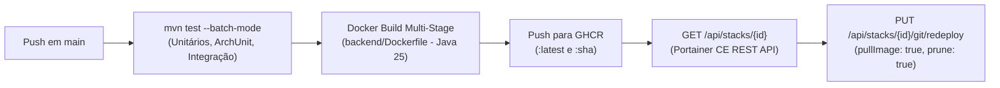

# 🚀 Deploy, Docker e Pipeline CI/CD

Este documento descreve como a aplicação é empacotada, testada e implantada em produção.

---

## 1. Pipeline CI/CD do Backend (GitHub Actions → GHCR → Portainer CE)

O workflow [`.github/workflows/deploy-backend.yml`](file:///home/tiago.godoy@db1.com.br/workspace/tiaggofg/secret-santa/.github/workflows/deploy-backend.yml) é disparado automaticamente em push na branch `main` (quando há alterações em `backend/**`, `docker-compose.prod.yml` ou no próprio workflow) ou manualmente via `workflow_dispatch`.

### Segredos / Variáveis Necessários no GitHub
- `PORTAINER_URL`: URL base da instância Portainer CE.
- `PORTAINER_API_KEY`: Chave de API (`X-API-Key`) do Portainer CE.
- `PORTAINER_STACK_ID`: ID da stack no Portainer.
- `PORTAINER_ENDPOINT_ID`: ID do ambiente/endpoint Docker no Portainer.
- `PORTAINER_GIT_USERNAME` / `PORTAINER_GIT_PASSWORD` (opcional, se repositório privado).

---

## 2. Containerização do Backend (`Dockerfile` e `docker-compose.prod.yml`)

- **Build Multi-Stage** ([`backend/Dockerfile`](file:///home/tiago.godoy@db1.com.br/workspace/tiaggofg/secret-santa/backend/Dockerfile)):
  1. Estágio `build` (`maven:3.9-eclipse-temurin-25`): baixa dependências offline e empacota o JAR.
  2. Estágio final (`eclipse-temurin:25-jre`): instala `curl` para healthcheck, cria usuário não-root `appuser` e executa `app.jar` na porta `8080`.
- **Produção** ([`docker-compose.prod.yml`](file:///home/tiago.godoy@db1.com.br/workspace/tiaggofg/secret-santa/docker-compose.prod.yml)):
  - Puxa `ghcr.io/tiaggofg/secret-santa-backend:latest`.
  - Configura `extra_hosts` (`host.docker.internal:host-gateway`) e healthcheck em `http://localhost:8080/api/v1/health` a cada `15s`.

---

## 3. Deploy do Frontend (Vercel)

- O frontend Angular é publicado como SPA estática na **Vercel**.
- [`frontend/vercel.json`](file:///home/tiago.godoy@db1.com.br/workspace/tiaggofg/secret-santa/frontend/vercel.json) redireciona todas as rotas (`/(.*)`) para `/index.html`, permitindo deep linking nas rotas `/g/:groupId`, `/g/:groupId/admin`, `/cadastro` e `/reset/:token`.
- Durante o build (`npm run build`), o script [`scripts/set-env.mjs`](file:///home/tiago.godoy@db1.com.br/workspace/tiaggofg/secret-santa/frontend/scripts/set-env.mjs) injeta `API_BASE_URL` no arquivo de ambiente antes de executar `ng build`.
