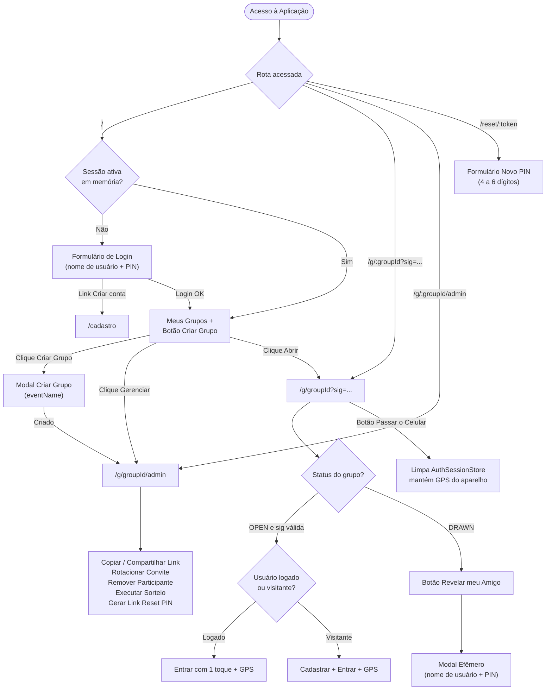
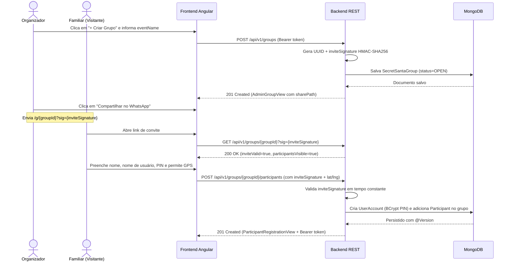
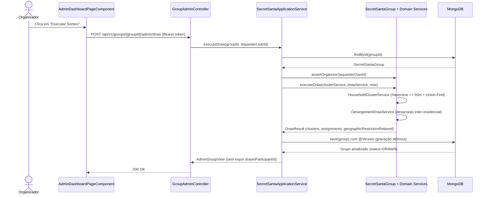
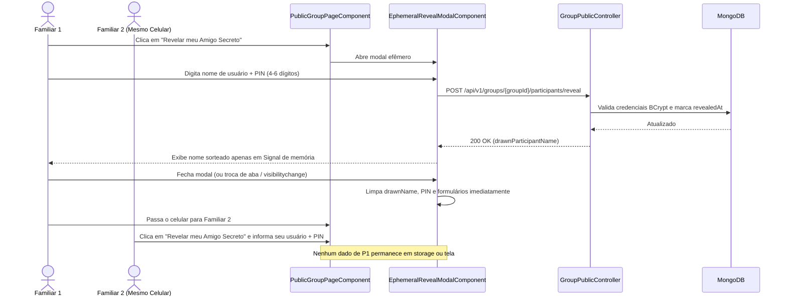
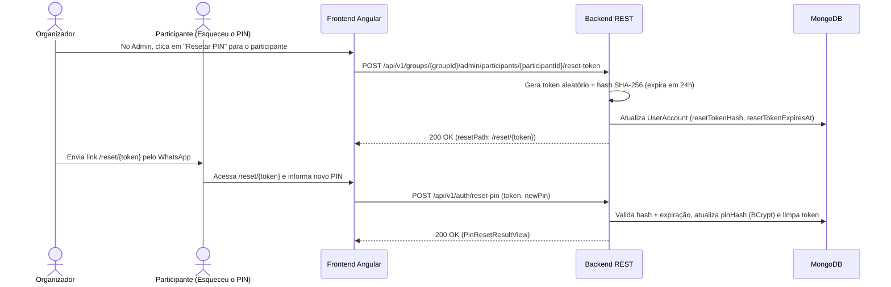

# 🔄 Fluxos de Usuário e Diagramas de Sequência

Este documento detalha a jornada completa do usuário no Frontend Angular e os diagramas de sequência das principais operações ponta a ponta.

---

## 1. Fluxograma Geral da Aplicação

---

## 2. Sequência 1 — Criação de Grupo e Ingresso por Convite Assinado

---

## 3. Sequência 2 — Execução do Sorteio com Restrição Geográfica

---

## 4. Sequência 3 — Revelação Efêmera e Modo "Passar o Celular"

---

## 5. Sequência 4 — Redefinição de PIN via Token Único

