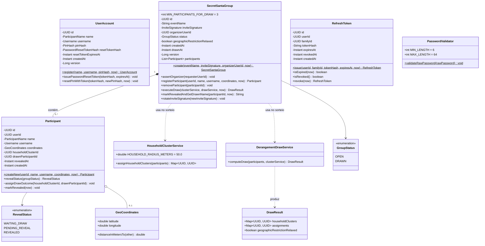
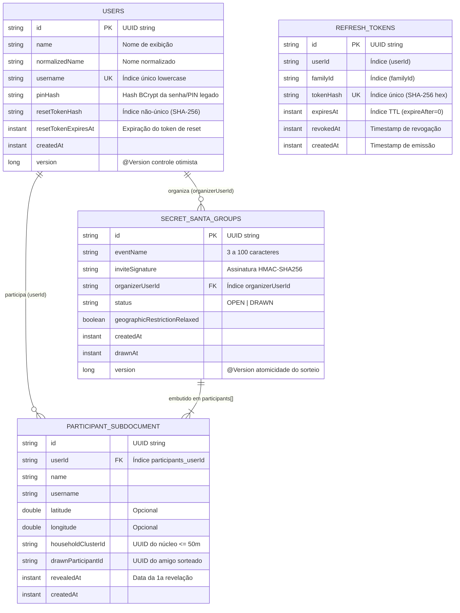
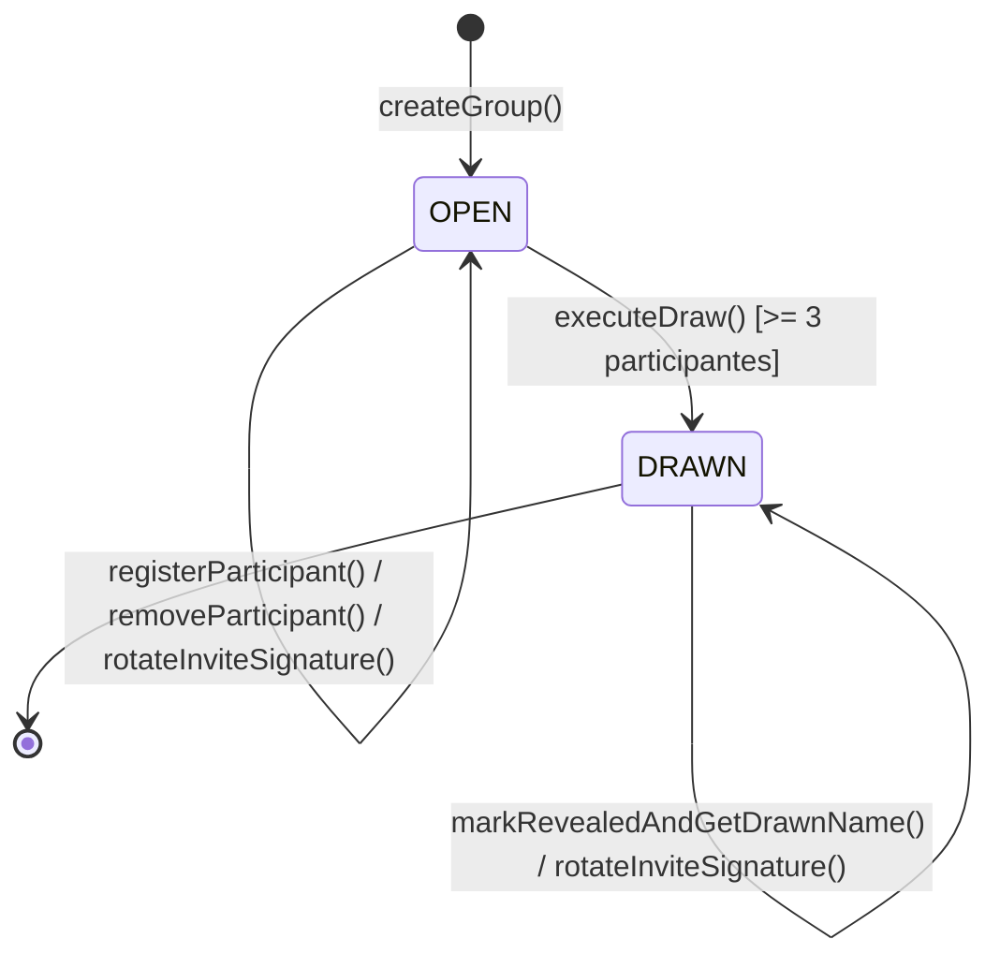
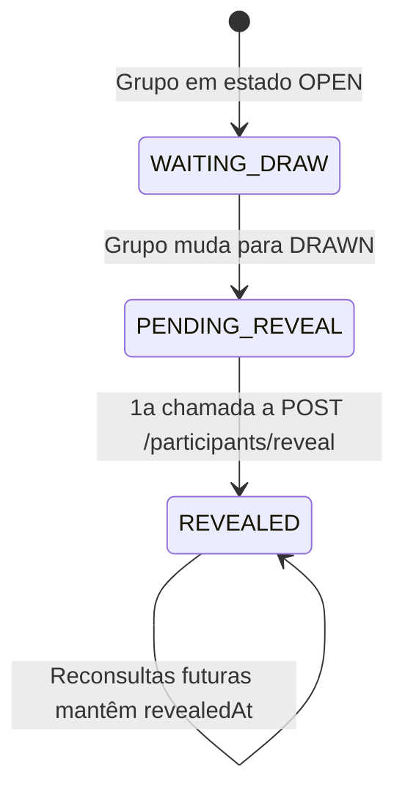

# 🧩 Modelo de Domínio, Diagrama de Classes e Dados

Este documento descreve os agregados, entidades, value objects, documentos MongoDB e transições de estado do sistema.

---

## 1. Diagrama de Classes do Domínio (`com.secretsanta.domain`)

---

## 2. Diagrama Entidade-Relacionamento / Documentos MongoDB

No MongoDB (`secret_santa`), o modelo relacional é mapeado para três collections principais (`users`, `secret_santa_groups` e `refresh_tokens`), preservando a fronteira dos agregados do DDD:

### Índices Gerenciados pelo Mongock

A classe [`SecretSantaIndexesChangeUnit`](file:///home/tiago.godoy@db1.com.br/workspace/tiaggofg/secret-santa/backend/src/main/java/com/secretsanta/infrastructure/persistence/SecretSantaIndexesChangeUnit.java) garante de forma idempotente os seguintes índices:
- Collection `users`:
  - `username` (único, ascendente)
  - `resetTokenHash` (ascendente)
- Collection `secret_santa_groups`:
  - `organizerUserId` (ascendente)
  - `participants_userId` (ascendente em `participants.userId`)

---

## 3. Máquina de Estados

### 3.1. Ciclo de Vida do Grupo (`GroupStatus`)

### 3.2. Status de Revelação do Participante (`RevealStatus`)

